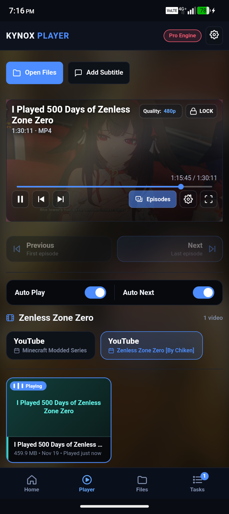
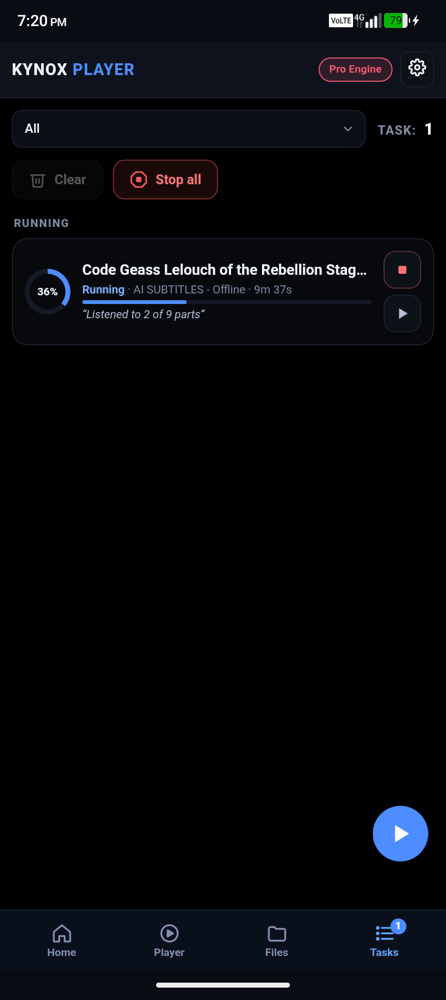
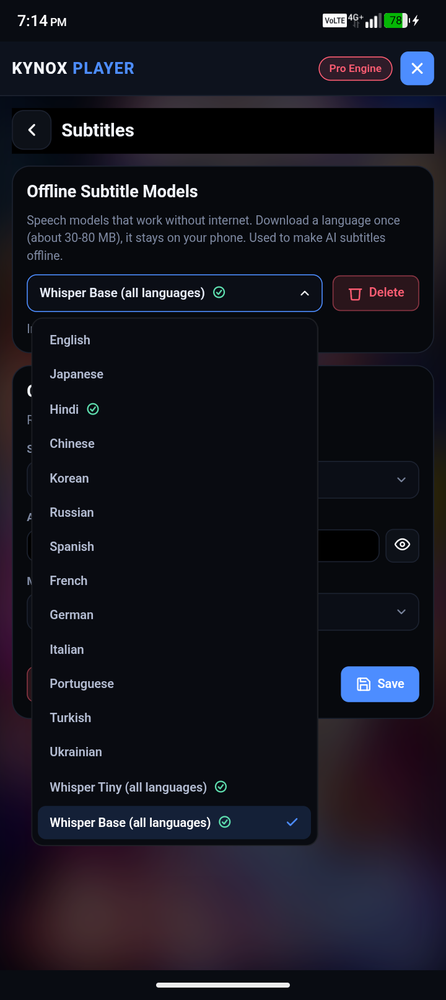

# Astra Player

**A fast, good-looking video and anime player for Android, with AI subtitles that work offline.**

 &nbsp;
 &nbsp;

---

## Why Astra Player

Astra Player is built for people who keep a library of anime, series and videos on their phone. It plays almost any file, remembers where you stopped, and can create subtitles for videos that have none.

## Features

**Playback**
- Hardware decoding with an automatic fallback to bundled FFmpeg decoders, so 10-bit and H.265 files play on low-end phones
- Resume where you stopped, the last watched video waits for you in the player
- Series queue, Auto Play, Auto Next, episode drawer, chapters, audio and subtitle track switching
- Gestures, lock screen, fullscreen, speed and quality controls

**Library**
- Home with Continue Watching and your playlists, built from your folders
- Files browser with search, hidden files switch and original file names
- Online covers for anime, series and movies (AniList, TVmaze, iTunes, Wikipedia, YouTube thumbnails). No account or key needed

**AI subtitles**
- **Offline:** Vosk speech models, downloaded once per language (about 30 to 80 MB), nothing leaves your phone
- **Online (optional):** bring your own key for Groq or any OpenAI compatible Whisper service. The key stays on your phone
- **Whisper:** download Whisper Tiny or Base in Settings and choose it as the subtitle model (offline, can translate to English)
- Task Manager with real progress, pause, stop and filters. Unfinished jobs wait as Paused and a small background service keeps the app alive while a job runs

**Customize**
- Accent colors (blue, red, orange, yellow, green, white) and a pure black mode
- Settings split into General, Player, Storage, Customize and Subtitles

## Install

1. Open the [Releases](https://github.com/astracore0/astra-player-app/releases) page and download the latest `.apk`.
2. Install it (Android asks you to allow installing from your browser or file manager).
3. On first start allow **All files access** so the app can read your media folder.

The app tells you when a newer stable version is out (Settings > App info). Alpha and beta tags are ignored.

## Requirements

- Android 7.0 or newer
- 2 GB of RAM or more is comfortable. The app also runs on 32 bit phones with about 2 GB

## Build it yourself

1. Fork or push this repository to GitHub.
2. Go to **Actions > Build Android app > Run workflow**.
3. Download the APK from the run, or from the new release it publishes.

The app is signed with a fixed key so new builds install over the old one. Every change is listed in [CHANGELOG.md](CHANGELOG.md).

## Privacy

- Your videos and subtitles stay on your phone.
- Online features (covers, online AI subtitles, update check) only run when you use them, and only send what they need: a title, or a short audio piece to the speech service you chose.
- API keys are stored on the device only.

## Roadmap

- Skip intro and outro, library search, cast to TV
- Import history from other players
- A support page for the developer

## License

MIT. See [LICENSE](LICENSE). Third party parts and their licenses are listed in [THIRD_PARTY_NOTICES.md](THIRD_PARTY_NOTICES.md).
